# 15 màn tham chiếu

Profile: reference15. Nguồn chung: SWF có hash trong REFERENCE.md, root frame 15; fixtures/reference15.json giữ bản dữ liệu đối chiếu. Không xoay/lật map. Mỗi board 10 hàng × 15 cột kể cả void padding. Tên Stage giữ thứ tự bản gốc.

Group 1 = 1–4 (đã có switch/bridge và fragile); group 2 = 5–6; group 3 = 7–9 (có split); group 4 = 10–15 (hỗn hợp). Group phục vụ harness theo ID, không phải phân loại độc quyền cơ chế.

| Ảnh app | Stage / passcode | Group | Cơ chế xuất hiện ngoài floor/goal | Optimal actions | Chứng nhận |
|---|---|---:|---|---:|---|
| 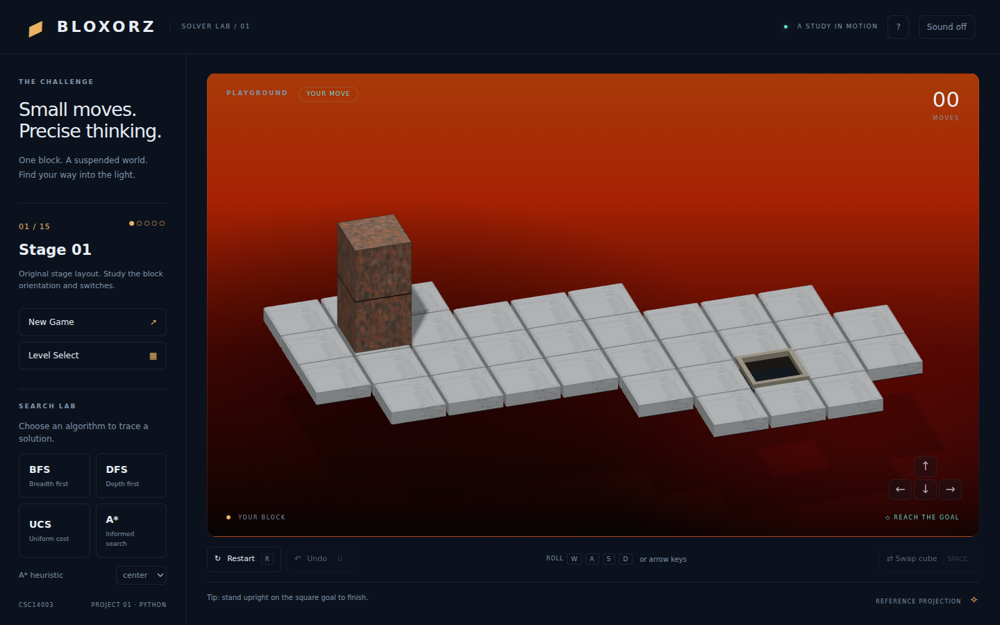 | 01 / 780464 | 1 | — | 7 | Verified, unit + SWAP |
| 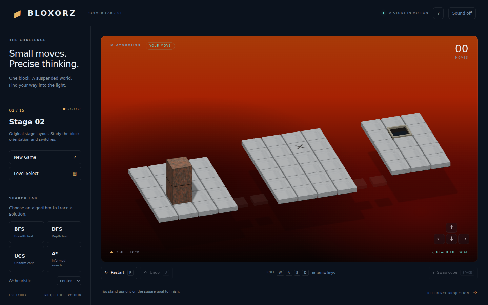 | 02 / 290299 | 1 | bridge, heavy_switch, soft_switch | 17 | Verified, unit + SWAP |
| 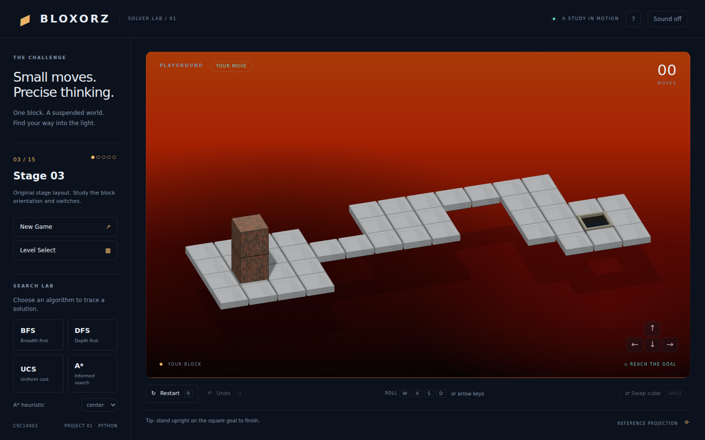 | 03 / 918660 | 1 | — | 22 | Verified, unit + SWAP |
| 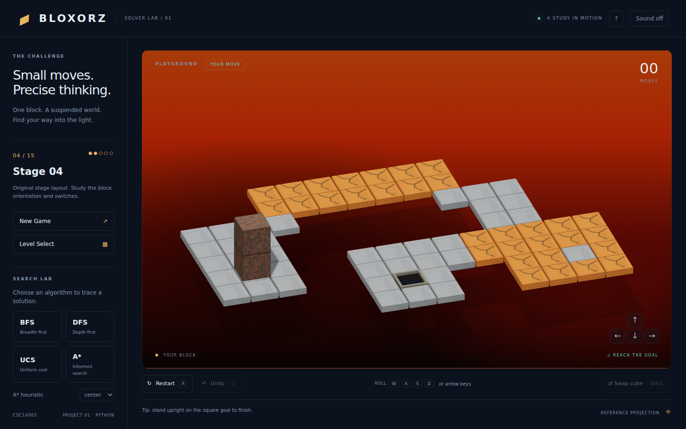 | 04 / 520967 | 1 | fragile | 28 | Verified, unit + SWAP |
| 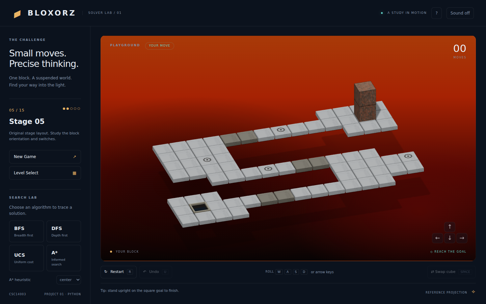 | 05 / 028431 | 2 | bridge, soft_switch | 33 | Verified, unit + SWAP |
| 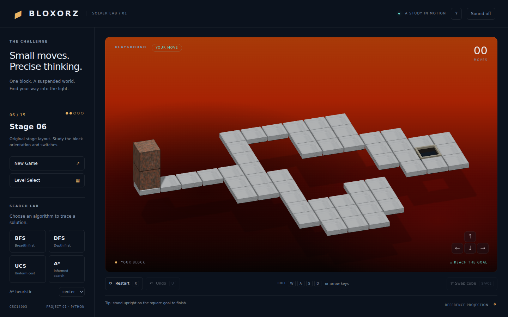 | 06 / 524383 | 2 | — | 35 | Verified, unit + SWAP |
| 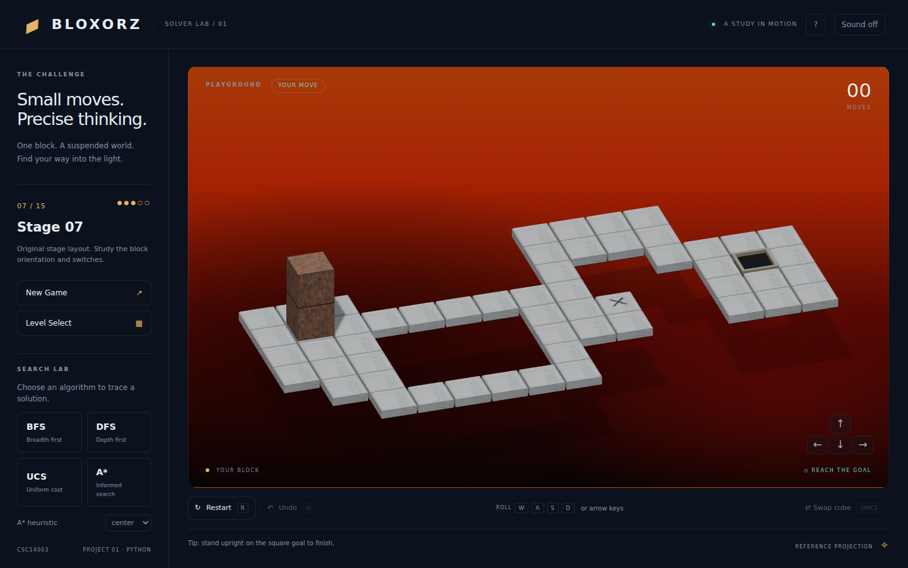 | 07 / 189493 | 3 | bridge, heavy_switch | 44 | Verified, unit + SWAP |
| 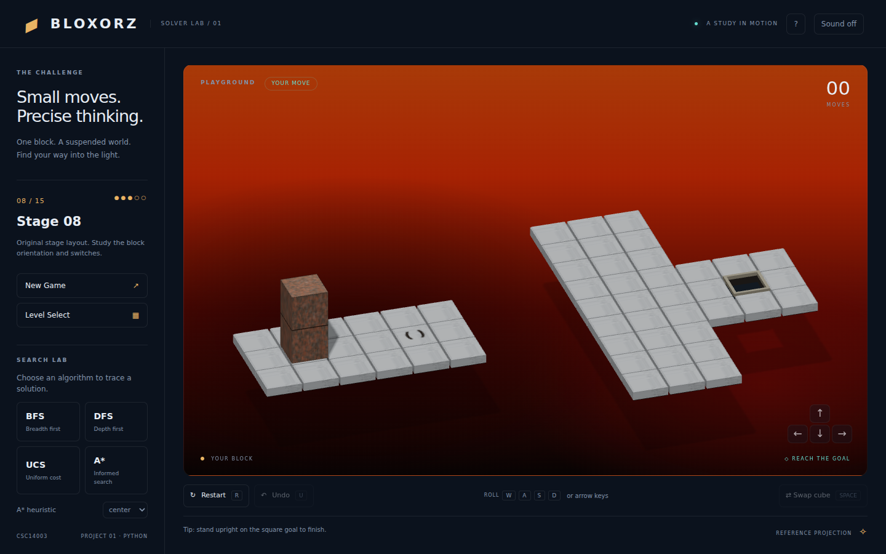 | 08 / 499707 | 3 | split_switch | 11 | Verified, unit + SWAP |
| 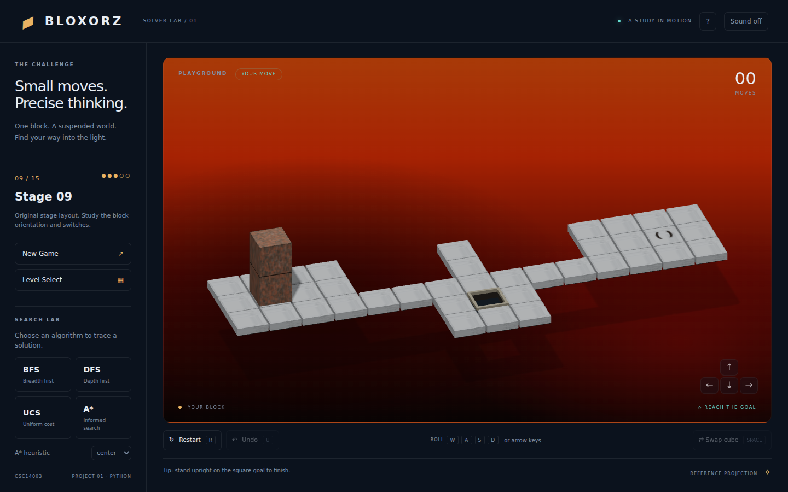 | 09 / 074355 | 3 | split_switch | 25 | Verified, unit + SWAP |
| 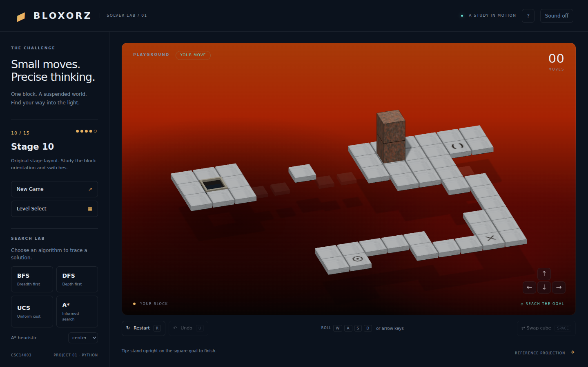 | 10 / 300590 | 4 | bridge, heavy_switch, soft_switch, split_switch | 58 | Verified, unit + SWAP |
| 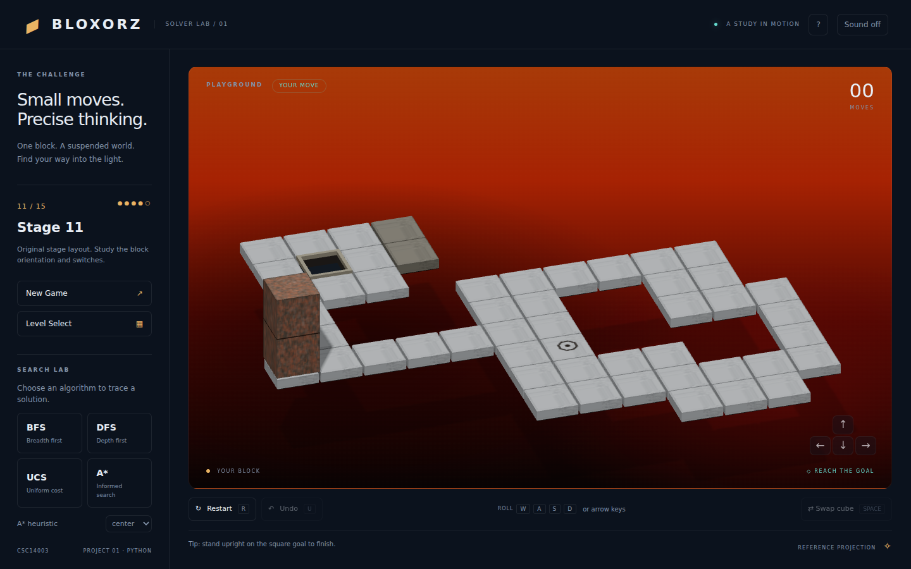 | 11 / 291709 | 4 | bridge, soft_switch | 47 | Verified, unit + SWAP |
| 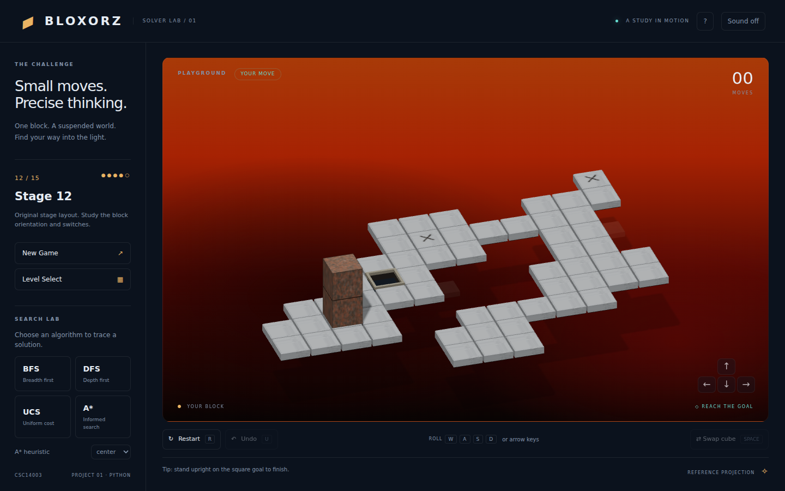 | 12 / 958640 | 4 | bridge, heavy_switch | 65 | Verified, unit + SWAP |
| 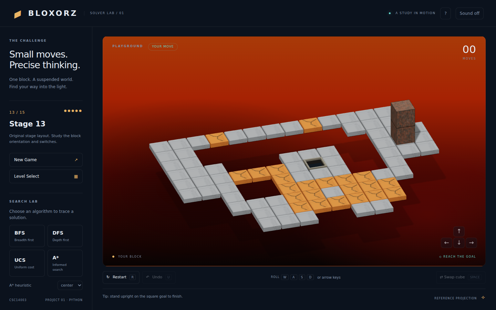 | 13 / 448106 | 4 | fragile | 46 | Verified, unit + SWAP |
| 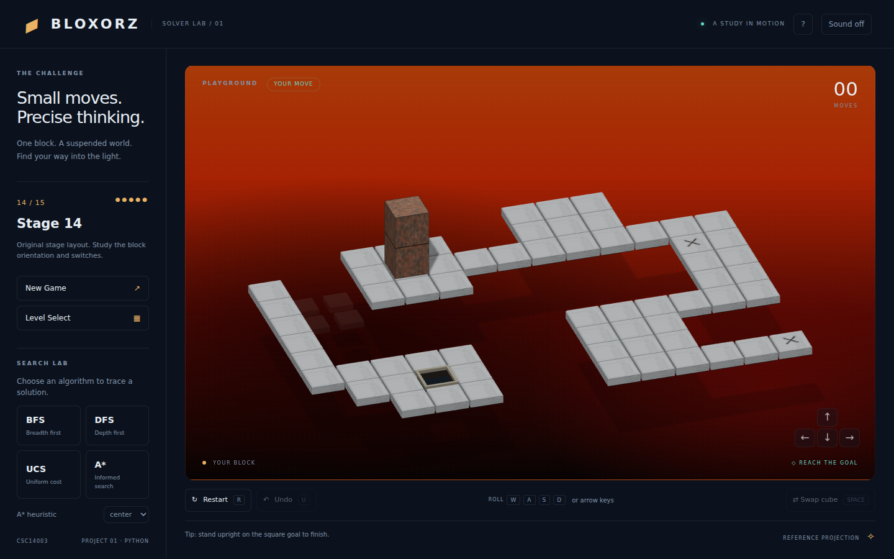 | 14 / 210362 | 4 | bridge, heavy_switch | 67 | Verified, unit + SWAP |
| 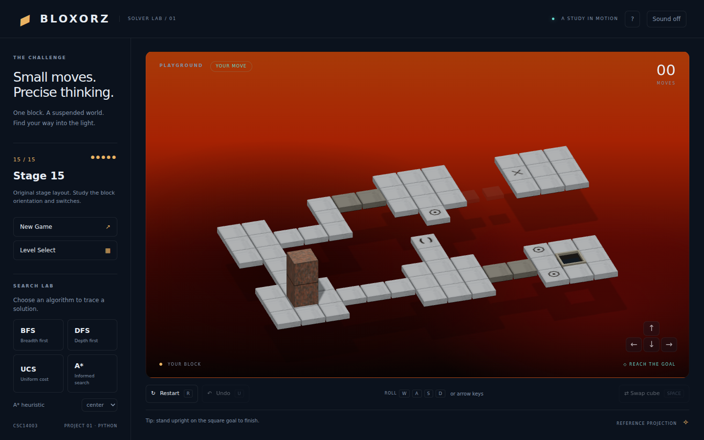 | 15 / 098598 | 4 | bridge, heavy_switch, soft_switch, split_switch | 61 | Verified, unit + SWAP |

Có mặt không tự chứng minh cơ chế bắt buộc; bản này không áp dụng ablation claim của bộ coursework cũ. Expanded/discovered và hash chi tiết ở LEVEL_VERIFICATION.md. Các chứng nhận áp dụng mô hình atomic rules hiện tại; không áp dụng mọi hành vi frame trung gian của Flash.
